<picture><source media="(prefers-color-scheme: light)" srcset="assets/hero-light.svg"></picture>
<a href="https://github.com/softoblivion/premiere-deck/releases/latest/download/PremiereDeck.exe"><picture><source media="(prefers-color-scheme: light)" srcset="assets/row-premiere-deck-light.svg"></picture></a>
<a href="https://github.com/softoblivion/media-saver/releases/latest/download/MediaSaver.exe"><picture><source media="(prefers-color-scheme: light)" srcset="assets/row-media-saver-light.svg"></picture></a>
<a href="https://github.com/softoblivion/media-forge/releases/latest/download/MediaForge.exe"><picture><source media="(prefers-color-scheme: light)" srcset="assets/row-media-forge-light.svg"></picture></a>
<a href="https://github.com/softoblivion/frame-notes/releases/latest/download/FrameNotes.exe"><picture><source media="(prefers-color-scheme: light)" srcset="assets/row-frame-notes-light.svg"></picture></a>
<a href="https://github.com/softoblivion/cute-mic-control/releases/latest/download/MicControl.exe"><picture><source media="(prefers-color-scheme: light)" srcset="assets/row-mic-control-light.svg"></picture></a>

